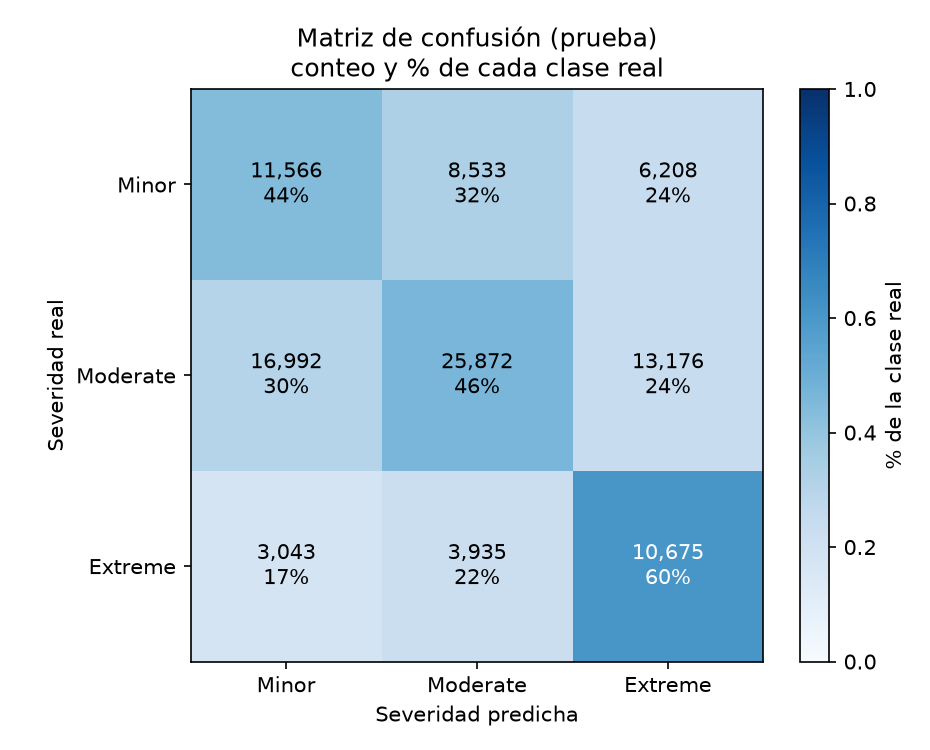
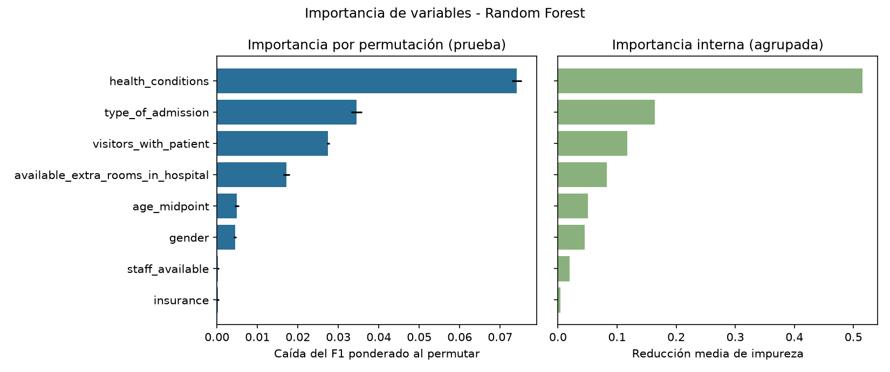

# Hallazgos: predicción de severidad con Random Forest

_Hospital San Juan de Dios de Rionegro (caso hipotético) · Generado automáticamente el 2026-11-09 02:06_

## 1. Pregunta de negocio

> Al momento de la admisión de un paciente, ¿con qué desempeño puede un modelo predecir su nivel de gravedad (Severity of Illness: Minor, Moderate, Extreme) a partir de información demográfica, antecedentes de salud, tipo de ingreso y variables logísticas disponibles, para apoyar el triaje preliminar y la planificación anticipada de camas y personal?

## 2. Respuesta

El modelo **mejora de forma modesta** a una regla trivial; sirve, como mucho, como una señal complementaria débil. Con los datos de admisión disponibles, el modelo acierta la severidad en **48.1%** de los pacientes de prueba; una regla que siempre dijera «Moderate» acertaría **56.0%**. Al ponderar por clase (F1), el modelo obtiene **0.491** frente a **0.403** de la regla trivial (diferencia +0.089). Valoración según el criterio interno del proyecto: **utilidad limitada**.

## 3. Hallazgos principales

- Se evaluó en 100,000 pacientes de prueba que el modelo no vio al entrenar.
- Clase mejor identificada: **Extreme** (recall 60.5%); la más difícil: **Minor** (recall 44.0%).
- De 17,653 pacientes realmente **Extreme**, el modelo detectó 10,675 (60.5%) y no detectó 6,978 (3,043 como Minor; 3,935 como Moderate).
- Variables con mayor aporte (importancia por permutación): health_conditions (0.0741), type_of_admission (0.0345), visitors_with_patient (0.0274).

## 4. Cómo leer las gráficas

Cada fila es la severidad real y cada columna la que predijo el modelo. La diagonal son los aciertos; fuera de ella están los errores. El porcentaje indica qué parte de cada clase real cayó en cada predicción.

Izquierda: cuánto empeora el modelo si se «desordena» una variable (cuanto más baja el F1, más la usa el modelo). Derecha: importancia interna del bosque, agrupando las categorías de una misma variable. Valores cercanos a cero indican que la variable casi no ayuda a predecir.

## 5. Confiabilidad del resultado

- División 80/20 estratificada con semilla fija (42); resultados reproducibles.
- Entrenamiento con 400,000 filas (entrenamiento con el 100 % de la partición de entrenamiento).
- Configuración elegida comparando 7 alternativas (RF-2); criterio: F1 ponderado y recall de Extreme.
- Una sola partición de prueba: no se midió la variabilidad entre particiones.

## 6. Errores y limitaciones

- Las variables disponibles al ingreso tienen poder discriminante limitado; el desempeño medido no debe extrapolarse a otros hospitales o periodos sin validación local.
- El dataset es público y de origen no verificado; podría no representar a la población del hospital.
- Se asume que visitors_with_patient, staff_available y available_extra_rooms_in_hospital se conocen en el momento de la admisión; si no, habría que retirarlas.
- La búsqueda de hiperparámetros se hizo en una submuestra estratificada de 100,000 filas por tiempo de cómputo; el modelo final usa todo el entrenamiento.
- Los modelos con hojas pequeñas (más pesados) se excluyeron de la selección para que el modelo exportado pese menos de lo permitido por GitHub.
- No se evaluó equidad por género, edad o seguro; antes de cualquier uso real se requiere auditoría de sesgos.
- Las importancias por permutación son asociaciones predictivas, no causas clínicas.
- No debe usarse como diagnóstico ni para decidir tratamiento: es solo apoyo administrativo preliminar.

## 7. Recomendaciones operativas

- **No** usar este modelo para planificar camas ni personal con la información actual.
- Mantener el triaje manual: el modelo omitiría 6,978 de 17,653 pacientes Extreme.
- Evaluar variables adicionales disponibles al ingreso (signos vitales, motivo de consulta, escala de triaje) antes de repetir el estudio.
- Validar con datos propios del hospital y auditar sesgos (género, edad, seguro) antes de cualquier piloto.
- Repetir la evaluación periódicamente para detectar deterioro del desempeño.

## 8. Advertencia

**Este modelo es un apoyo administrativo y preliminar. NO es un diagnóstico ni una decisión clínica autónoma: requiere validación clínica, revisión de sesgos y supervisión humana.**
